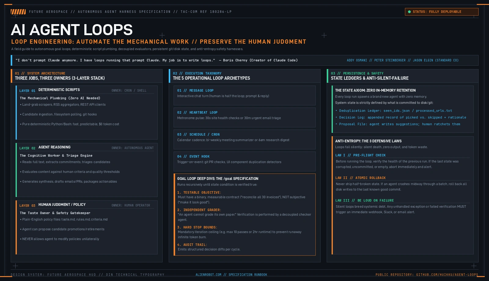
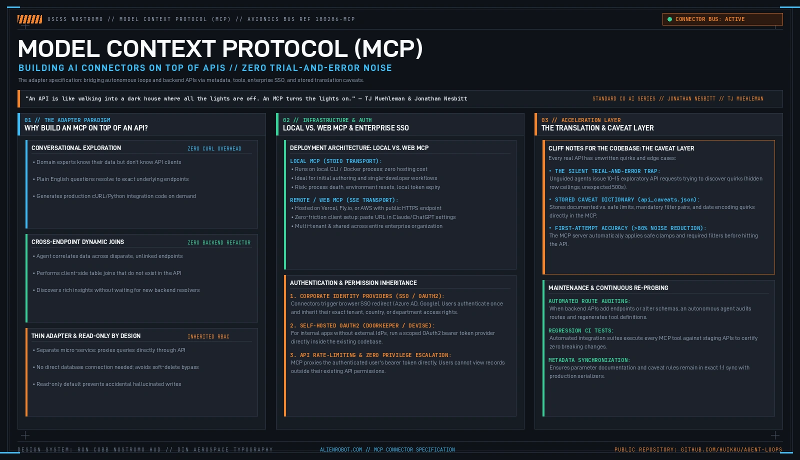

# AI Agent Loops: Loop Engineering & Autonomous Verification Guide



> **"I don't prompt Claude anymore. I have loops running that prompt Claude. My job is to write loops."**  
> — Boris Cherny, Creator of Claude Code (Anthropic)

---

## Executive Overview

For the first two years of generative AI, working with language models meant manual, turn-by-turn prompting: a human typed an instruction into a chat window, waited for an answer, inspected the text, and manually pasted in the next correction.

Today, advanced software development and knowledge work have crossed into **Loop Engineering** (popularized by Boris Cherny, Addy Osmani, Peter Steinberger, and Standard Co's AI Series). In loop engineering:
1. The human developer no longer acts as the mechanical conversational bottleneck.
2. The model becomes a computational subroutine called by an automated outer loop.
3. System architecture focuses on three pillars: **deterministic script plumbing**, **decoupled evaluation**, and **plain-English human taste policies**.

The core operational doctrine of this guide is:  
**Automate the mechanical work. Preserve the human judgment.**

---

## Quick Navigation

- [1. The 3-Layer System (Three Jobs, Three Owners)](#1-the-3-layer-system-three-jobs-three-owners)
- [2. The 5 Operational Loop Archetypes](#2-the-5-operational-loop-archetypes)
- [3. Deep Dive: The Goal Loop (`/goal`)](#3-deep-dive-the-goal-loop-goal)
- [4. State & Memory Architecture](#4-state--memory-architecture)
- [5. Anti-Entropy: The 3 Defensive Laws Against Silent Failures](#5-anti-entropy-the-3-defensive-laws-against-silent-failures)
- [6. Production Case Studies](#6-production-case-studies)
- [7. The Hands & Senses: Model Context Protocol (MCP) Connectors](#7-the-hands--senses-model-context-protocol-mcp-connectors)
- [8. Onboarding Prompt for Autonomous Coding Agents](#8-onboarding-prompt-for-autonomous-coding-agents)
- [9. Repository Structure & Reference Implementations](#9-repository-structure--reference-implementations)

---

## 1. The 3-Layer System (Three Jobs, Three Owners)

The most common failure in agent design is asking an LLM to perform tasks that deterministic code handles faster, cheaper, and with 100% reliability. A production loop partitions responsibility into three distinct layers:

```
┌────────────────────────────────────────────────────────────────────────┐
│ LAYER 1: DETERMINISTIC SCRIPTS (Owner: Shell / Cron / CI Pipeline)     │
│ • Land-grab candidate scraping, RSS parsing, REST API querying         │
│ • Filesystem polling, Git operations, JSON payload normalization       │
│ • Fast, predictable, zero-token cost, zero hallucination risk          │
└───────────────────────────────────┬────────────────────────────────────┘
                                    │ Candidates & Raw Context
                                    ▼
┌────────────────────────────────────────────────────────────────────────┐
│ LAYER 2: AGENT REASONING (Owner: Autonomous AI Agent)                  │
│ • Reads full candidate context, extracts commitments, triages loose ends│
│ • Evaluates content against human criteria and quality thresholds      │
│ • Synthesizes digests, drafts emails/PRs, packages actionable items    │
└───────────────────────────────────┬────────────────────────────────────┘
                                    │ Judged Against Rules
                                    ▼
┌────────────────────────────────────────────────────────────────────────┐
│ LAYER 3: HUMAN JUDGMENT & POLICY (Owner: Human Operator)               │
│ • Plain-English files: taste.md, rules.md, criteria.md                 │
│ • Defines what "good" means, subjective editorial tone, safety bounds  │
│ • Agent may propose changes, but ONLY the human can modify policies    │
└────────────────────────────────────────────────────────────────────────┘
```

### Layer Partitioning Breakdown

| Layer | Responsibility | Execution Engine | Token Cost | Modification Authority |
|---|---|---|---|---|
| **Layer 1: Deterministic Scripts** | Mechanical plumbing, I/O, fetching, formatting | Python / Bash / cURL | **$0.00** | Software Engineer |
| **Layer 2: Agent Reasoning** | Contextual analysis, triage, synthesis, draft generation | Claude / GPT / Local LLM | Variable | Autonomous Agent |
| **Layer 3: Human Judgment** | Taste, ethical constraints, priorities, final sign-off | Markdown text files | N/A | **Human Only** |

> [!IMPORTANT]
> **The Authority Asymmetry Principle:**  
> The agent is encouraged to analyze patterns and append proposals (e.g. *"Author X has yielded a 90% pick rate over 14 runs; propose adding to primary feeds"*), but it must **never** be granted write permissions to modify its own policy files. The human operator remains the sole taste authority.

---

## 2. The 5 Operational Loop Archetypes

Loop architectures fall into five distinct execution patterns:

```
                      ┌─────────────────────────┐
                      │    5 LOOP ARCHETYPES    │
                      └────────────┬────────────┘
         ┌──────────────┬──────────┴───────────┬──────────────┐
         ▼              ▼                      ▼              ▼
   ┌───────────┐  ┌───────────┐          ┌───────────┐  ┌───────────┐
   │  MESSAGE  │  │ HEARTBEAT │          │ SCHEDULE  │  │   HOOK    │
   │ Turn-based│  │ Metronome │          │ Cadence   │  │ Event-    │
   │ Chat loop │  │ Liveness  │          │ Cron job  │  │ Triggered │
   └───────────┘  └───────────┘          └───────────┘  └───────────┘
                                      │
                                      ▼
                                ┌───────────┐
                                │   GOAL    │
                                │ Contract- │
                                │ Driven    │
                                └───────────┘
```

### 1. The Message Loop (Interactive Human-in-the-Loop)
- **Mechanism:** The human is active half of the loop. Turn-by-turn prompt and response.
- **Use Case:** Brainstorming, ad-hoc debugging, exploratory architectural planning.

### 2. The Heartbeat Loop (Liveness Pulse)
- **Mechanism:** A high-frequency metronome running on fixed short intervals (e.g., 30s to 5m).
- **Use Case:** "Is my production service healthy?", "Did a critical P0 incident alert fire in PagerDuty?", "Has an urgent client escalation arrived in my inbox?"

### 3. The Schedule / Cron Loop (Cadence Engine)
- **Mechanism:** A clock-driven interval executing on fixed temporal boundaries (e.g., every morning at 06:00, or Tuesdays and Thursdays at 17:00).
- **Use Case:** Daily news/research digests, bi-weekly company meeting note summarizers, weekly dropped-commitment audits.

### 4. The Event Hook Loop (Triggered Reactive Execution)
- **Mechanism:** Listens for external state transitions (git commits, webhooks, pull requests, file changes).
- **Use Case:** Automated PR code reviewer, UI component duplication detector (verifies that newly written React/Vue components do not duplicate existing design system primitives), lint error eradication.

### 5. The Goal Loop (`/goal`) (Contract-Driven Autonomous Loop)
- **Mechanism:** Runs recursively and iteratively until a testable contract is verified true by an independent evaluator.
- **Use Case:** Complex migrations, cross-referencing multi-file inventories, test-suite passing runs.

---

## 3. Deep Dive: The Goal Loop (`/goal`)

The Goal Loop represents the true frontier of agentic engineering. Unlike open-ended conversational prompts, a Goal Loop lives and dies by its contract.

### The Anatomy of a Production Goal Loop

A production goal loop requires four mandatory components:

```
┌────────────────────────────────────────────────────────────────────────┐
│ 1. TESTABLE OBJECTIVE                                                  │
│    Must be a binary, programmatic definition of done.                  │
│    ✓ GOOD: "Iterate until all 30 markdown posts contain 2 valid links" │
│    ✗ BAD:  "Keep working until my presentation looks good"             │
├────────────────────────────────────────────────────────────────────────┤
│ 2. INDEPENDENT VERIFIER (THE DECOUPLED GRADER)                         │
│    "An agent cannot grade its own paper."                              │
│    The generator agent and the verification checker must be decoupled. │
├────────────────────────────────────────────────────────────────────────┤
│ 3. HARD STOP BOUNDS (THE RUNAWAY CIRCUIT BREAKER)                      │
│    Mandatory iteration ceiling (e.g., max 10 passes, 2-hour timeout).  │
│    Prevents catastrophic token consumption loops.                      │
├────────────────────────────────────────────────────────────────────────┤
│ 4. PERSISTENT AUDIT TRAIL                                              │
│    Appends structured diffs and rationale to disk on every iteration.  │
└────────────────────────────────────────────────────────────────────────┘
```

---

## 4. State & Memory Architecture

### The Ephemeral Axiom: Zero In-Memory Retention
Every execution of an automated loop spawns a **brand-new agent instance** with zero memory of previous runs.

Therefore, loop engineering is fundamentally the science of **what is written to persistent disk or git between runs**:

```
repo-root/
├── state/
│   ├── seen_ids.json       # Deduplication set: hashes/IDs of processed records
│   ├── decisions.log       # Append-only ledger: [timestamp] [id] [PICKED/SKIPPED] [reason]
│   └── proposals.md        # Agent proposes rule adjustments; human reviews and ratchets
├── policy/
│   ├── taste.md            # Human-authored editorial rules and quality thresholds
│   └── constraints.md      # Safety boundaries, blacklist criteria, format rules
└── scripts/
    ├── ingest.py           # Layer 1 deterministic fetcher
    └── verify.py           # Layer 2/3 independent contract grader
```

### The State Ledger Pattern
1. **Deduplication Set (`seen_ids.json`):** Tracks unique identifiers (URLs, email message-IDs, PR numbers) so the agent never wastes reasoning budget reprocessing existing items.
2. **Decision Ledger (`decisions.log`):** Every triage decision records a single-line audit entry:
   ```text
   2026-10-14T06:00:12Z | item_8841 | PICKED  | Matches high-signal criteria: novel hybrid attention benchmark
   2026-10-14T06:00:15Z | item_8842 | SKIPPED | Low substance: rehashed press release with no benchmark code
   ```
3. **Agent Proposal Queue (`proposals.md`):** The agent records longitudinal insights without altering live rules:
   ```markdown
   ## Proposed Policy Updates (2026-10-14)
   - [ ] Promote domain `arxiv.org/abs/2610.*` to auto-allowlist (12 consecutive picks)
   - [ ] Deprecate RSS feed `techcrunch-ai` (0 picks in 30 days due to generic SEO content)
   ```

---

## 5. Anti-Entropy: The 3 Defensive Laws Against Silent Failures

Automated loops fail in insidious ways. Unlike traditional code that crashes with a noisy traceback, an AI loop can quietly degrade:
- An API payload format changes slightly, so the fetcher returns an empty list.
- The agent reasons that "there is nothing to process" and exits cleanly with return code `0`.
- The operator assumes the system is healthy while customer tickets or dropped commitments pile up silently.

To defend against silent loop entropy, enforce **The Three Defensive Laws**:

```
┌────────────────────────────────────────────────────────────────────────┐
│ LAW I: THE PRE-FLIGHT INTEGRITY CHECK                                  │
│ Before executing a loop, verify the health of the previous run.        │
│ • Did the prior run produce output?                                    │
│ • Are state ledgers uncorrupted?                                       │
│ • If the prior state was anomalous, halt and raise an alert.           │
├────────────────────────────────────────────────────────────────────────┤
│ LAW II: ATOMIC ROLLBACK                                                │
│ Never commit or deploy partial state.                                  │
│ • If an agent crashes midway through a 30-item batch, roll back all    │
│   disk writes to the last known clean git commit.                      │
├────────────────────────────────────────────────────────────────────────┤
│ LAW III: BE LOUD ON FAILURE                                            │
│ Silent failures breed technical and organizational debt.               │
│ • Any unhandled exception, empty ingestion anomaly, or verification   │
│   rejection must trigger an immediate outbound webhook (Slack/Email).  │
└────────────────────────────────────────────────────────────────────────┘
```

---

## 6. Production Case Studies

### Case Study 1: The Dropped Commitments & Loose-Ends Reconciler
- **Problem:** Knowledge workers make dozens of commitments across Slack, email threads, meeting notes, and Jira. Items drop through the cracks.
- **Loop Architecture:**
  - *Layer 1:* Script pulls past 14 days of sent emails, Slack threads mentioning the user, and calendar meeting notes.
  - *Layer 2:* Agent evaluates threads, identifies unfulfilled promises ("I'll send the contract by Tuesday", "Let me check on those benchmarks"), and categorizes by urgency.
  - *Layer 3:* Human reviews the generated triage document, approves drafted reconciliation emails, and closes loose ends.

### Case Study 2: The 6-Day Automated Curated Newspaper
- **Problem:** Generic news aggregators deliver high-volume, low-signal SEO fluff.
- **Loop Architecture:**
  - *Layer 1:* Cron script fetches hundreds of candidate articles from RSS feeds and Hacker News APIs at 05:00.
  - *Layer 2:* Agent reads full article bodies, scores them against a personal `taste.md` document, and selects the top 5 pieces.
  - *Layer 3:* Produces a clean static HTML edition hosted on GitHub Pages. Decisions are logged to `decisions.log`.
  - *Result:* 2+ months of unattended daily publication with only 1 failure.

### Case Study 3: The 30-Post SEO Cross-Linker Goal Loop
- **Problem:** Manually checking and cross-linking 30 long-form blog posts is error-prone and tedious.
- **Loop Architecture:**
  - *Objective Contract:* Every post must contain at least 2 relevant, contextual internal links to other posts in the corpus.
  - *Verification Grader:* Independent AST script parses generated links, ensures target URLs exist, and confirms relevance.
  - *Runtime:* 4 minutes total execution time, 0 human interventions, 100% verified cross-links.

### Case Study 4: Frontend UI Component Duplication Hook
- **Problem:** Large teams frequently re-implement existing UI components (buttons, modals, input pickers) instead of reusing the design system.
- **Loop Architecture:**
  - *Trigger:* Git pre-push hook or PR webhook.
  - *Layer 2:* Agent parses newly added JSX/Vue files, checks the component registry, and flags near-duplicate implementations with a diff suggesting how to reuse existing primitives.

---

---

## 7. The Hands & Senses: Model Context Protocol (MCP) Connectors



> **"An API is like walking into a dark house where all the lights are off and having to stumble around to find the kitchen. An MCP turns the lights on."**  
> — TJ Muehleman & Jonathan Nesbitt, Standard Co (*AI Series: How to Build an MCP*)

While **Loops** act as the executive brain, scheduler, and feedback harness, **Model Context Protocol (MCP)** servers serve as the agent's hands, senses, and live data connectors.

### Why Build an MCP on Top of Your Existing API?
1. **The Discovery Barrier:** Domain specialists understand their data, but struggle with raw endpoints, cURL syntax, and pagination parameters. An MCP exposes structured metadata and tools so users can converse with their data directly in plain English.
2. **Cross-Endpoint Dynamic Joins:** An MCP allows an agent to correlate disparate endpoints (e.g. clinic inventory + epidemiological outbreak rates) and perform client-side joins without requiring backend developers to write bespoke resolvers.
3. **Conversational Integration Drafting:** Users can explore endpoints conversationally in chat and ask the agent to self-generate production cURL/Python integration code based on discovered queries.
4. **Thin Adapter & Zero Database Re-wiring:** The MCP server proxies calls through existing APIs, inheriting existing role-based access control (RBAC), tenant isolation, and database safeguards.

### Local MCP vs. Remote / Web MCP
- **Local MCP (stdio transport):** Runs on local CLI / Docker process; zero hosting cost. Ideal for initial authoring and single-developer workflows.
- **Remote / Web MCP (SSE transport):** Hosted on Vercel, Fly.io, or AWS with a public HTTPS endpoint. Zero-friction client setup (paste URL in Claude/ChatGPT settings) and shared across the entire enterprise organization.

### The Translation & Caveat Layer ("Cliff Notes for the Codebase")
Real-world APIs have unwritten quirks: silent row truncations, mandatory filter pairs, or timezone assumptions. Without guidance, agents burn 10–15 trial-and-error roundtrips discovering these limitations.

The **Translation & Caveat Layer** (`api_caveats.json`) stores these quirks directly in the MCP connector. The server automatically clamps parameters to safe limits and applies mandatory filters before hitting the API, eliminating trial-and-error noise by over 80%.

*Detailed documentation: [`docs/06-mcp-connectors-and-apis.md`](docs/06-mcp-connectors-and-apis.md)*  
*Working implementation: [`examples/05-mcp-api-connector/`](examples/05-mcp-api-connector)*

---

## 8. Onboarding Prompt for Autonomous Coding Agents

Copy and paste the specification below directly into **Claude Code**, **Codex**, or the **Antigravity CLI** to configure, audit, or build loops for your project:

```text
# Autonomous Loop & MCP Engineering Specification
Reference Architecture: https://github.com/huikku/agent-loops

You are an autonomous AI systems engineer. Your mission is to design, implement, and verify robust agentic loops using the 3-Layer System (Deterministic Scripts, Agent Reasoning, Human Judgment Policy) augmented with Model Context Protocol (MCP) connectors.

Enforce these strict architectural rules:

1. System Partitioning (The 3 Layers + MCP Hands):
   - Layer 1 (Deterministic Scripts): Use Python/Bash for all I/O, fetching, formatting, and file manipulation. Zero LLM involvement for mechanical tasks.
   - Layer 2 (Agent Reasoning): Use LLM evaluation only where semantic comprehension, extraction, synthesis, or creative drafting is strictly required.
   - Layer 3 (Human Policy): Load plain-English Markdown configuration files (taste.md, rules.md) as immutable operational constraints. The agent may append proposals to proposals.md, but MUST NEVER edit policy files directly.
   - Connectors (MCP Subsystems): Proxy API endpoints through lightweight MCP adapters. Consult the Translation & Caveat Layer (api_caveats.json) to apply safe clamps and mandatory filters on the first attempt without trial-and-error noise.

2. Loop Taxonomy:
   - Identify whether the task requires a Message Loop, Heartbeat Loop, Schedule/Cron, Event Hook, or Goal Loop.
   - If building a Goal Loop (/goal), enforce:
     a) A binary, testable definition of done.
     b) An independent grader/verifier ("an agent cannot grade its own paper").
     c) A hard stop ceiling (maximum iterations or wall-clock timeout).

3. State & Memory Management:
   - Treat every run as ephemeral. Do not rely on session memory.
   - Maintain persistent state via git or disk:
     - Deduplication set: state/seen_ids.json
     - Append-only audit ledger: decisions.log (timestamp | id | decision | reason)
     - Proposal file: proposals.md

4. Anti-Entropy & Failure Defenses:
   - Enforce Pre-Flight Checks: verify the integrity of prior run outputs before starting.
   - Enforce Atomic Rollback: git stash or discard partial writes if an iteration fails or aborts.
   - Enforce Loud Alerts: output clear exit codes and integrate outbound notification hooks on failure.

Begin by inspecting the workspace, reviewing candidate inputs, and proposing the minimal deterministic script harness before executing LLM reasoning.
```

---

## 9. Repository Structure & Reference Implementations

```
agent-loops/
├── assets/
│   ├── banner.webp                 # Nostromo Master Loop Engineering diagram
│   ├── banner.png                  # High-res PNG master
│   ├── banner.jpg                  # Optimized JPEG
│   ├── mcp-architecture.webp       # Nostromo MCP Subsystem Connector diagram
│   ├── mcp-architecture.png        # High-res PNG master
│   └── mcp-architecture.jpg        # Optimized JPEG
├── docs/
│   ├── 01-loop-archetypes.md       # In-depth mechanics of the 5 loop archetypes
│   ├── 02-three-layer-system.md    # Designing the scripts vs reasoning vs taste stack
│   ├── 03-state-and-memory.md      # Implementing persistent disk & git ledgers
│   ├── 04-anti-silent-failures.md  # Pre-flight, rollback, and alert harnesses
│   ├── 05-llm-onboarding.md        # Full prompt templates for coding agents
│   └── 06-mcp-connectors-and-apis.md # Complete MCP guide: APIs, auth, caveats
├── examples/
│   ├── 01-dropped-commitments/     # Scanner for email, Slack & meeting loose-ends
│   │   ├── scan_commitments.py
│   │   ├── prompt.md
│   │   └── sample_input.json
│   ├── 02-curated-digest-pipeline/ # 3-layer automated research newspaper
│   │   ├── fetch_candidates.py
│   │   ├── evaluate_digest.py
│   │   ├── taste.md
│   │   └── seen_urls.txt
│   ├── 03-goal-loop-harness/       # Contract-driven goal loop with independent grader
│   │   ├── run_goal_loop.py
│   │   ├── grader.py
│   │   └── contract.json
│   ├── 04-anti-silent-failure/     # Pre-flight, atomic rollback, and loud alerting
│   │   ├── preflight.py
│   │   ├── rollback_guard.py
│   │   └── alert_webhook.py
│   └── 05-mcp-api-connector/       # API-to-MCP adapter with Caveat Layer
│       ├── mcp_server.py
│       ├── mock_backend_api.py
│       ├── api_caveats.json
│       └── test_client.py
└── scripts/
    ├── generate_banner.py          # Script generating Master Loop HUD diagram
    └── generate_mcp_diagram.py     # Script generating MCP Connector HUD diagram
```

---

## Credits & References

- **Standard Co AI Series (Vol. 5):** *AI Agent Loops: Automate the Work, Keep the Judgment* by Jason Elgin ([YouTube Reference](https://www.youtube.com/watch?v=mo2MuSBbhQ0))
- **Standard Co AI Series (MCP Session):** *How to Build an MCP: Add an AI Connector on Top of Your API* by Jonathan Nesbitt & TJ Muehleman ([YouTube Reference](https://www.youtube.com/watch?v=YYSG1Cqyhrw))
- **Boris Cherny:** Creator of Claude Code at Anthropic (*"I don't prompt Claude anymore. I have loops running that prompt Claude."*)
- **Addy Osmani:** Engineering Director at Google (*"Loop Engineering: When Agents Prompt Agents"*)
- **Peter Steinberger:** Creator of OpenClaw & autonomous agent loops
- **Design System:** Late-70s aerospace cockpit typography and technical HUD graphics inspired by Ron Cobb's work on the USCSS Nostromo (*Alien*, 1979) and curated by [alienrobot.com](https://alienrobot.com).

---

*Open-sourced under the MIT License by [John Huikku](https://alienrobot.com).*

