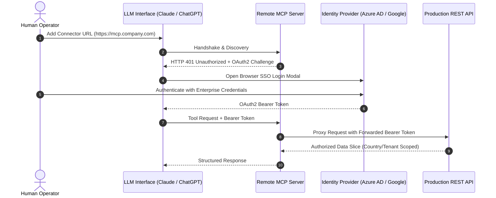

# Model Context Protocol (MCP): Building AI Connectors on Top of APIs

> **"An API is like walking into a dark house where all the lights are off and having to stumble around to find the kitchen. An MCP turns the lights on."**  
> — TJ Muehleman & Jonathan Nesbitt, Standard Co (*AI Series: How to Build an MCP*)

---

## 1. Executive Summary: The Adapter Paradigm

The **Model Context Protocol (MCP)** is an open protocol that standardizes how AI agents and language models connect to external data sources, enterprise tools, and backend APIs.

In loop engineering:
- **Loops are the Cognitive Engine (The Brain & Executive Control):** They manage triggers, goal contracts, state persistence, and anti-entropy safety harnesses.
- **MCPs are the Standardized Hands & Senses:** They expose system metadata, database queries, and API endpoints to the agent in a structured format the model can natively inspect and execute.

```
┌────────────────────────────────────────────────────────────────────────┐
│                        THE AGENTIC STACK                               │
├────────────────────────────────────────────────────────────────────────┤
│ OUTER LOOP: Schedule / Hook / Goal Controller                          │
│   └── INNER REASONING: Contextual Evaluation & Decision Ledger         │
│         └── MCP ADAPTER LAYER: Metadata, Tools, Resources & Prompts    │
│               └── EXISTING BACKEND: REST APIs, Databases, Enterprise IdP│
└────────────────────────────────────────────────────────────────────────┘
```

---

## 2. Why Build an MCP If You Already Have an API?

Software teams frequently ask: *"We already have a production REST API with Swagger documentation. Why do we need an MCP server?"*

### 1. The Discovery Barrier: Stumbling in the Dark
Even well-documented APIs present massive cognitive friction for domain experts (epidemiologists, business analysts, educators, operators). They understand their data domain deeply, but they do not know:
- How to construct `cURL` commands or configure HTTP headers.
- Which specific endpoint houses nested relational data.
- How to manage pagination tokens, query parameter encodings, or URL path parameters.

An MCP equips the agent with direct metadata about where data lives, how entities correlate, and how to execute queries conversationally.

### 2. Cross-Endpoint Joins Without Backend Engineering
Traditional APIs return data according to fixed endpoints (e.g., `/patients` and `/clinics`). If a user needs a synthesized view correlating patient outcomes with clinic staffing levels, a software engineer traditionally had to write a bespoke backend endpoint or GraphQL resolver.

An MCP allows the LLM to inspect multiple endpoints, query them sequentially, and perform dynamic client-side joins that never existed in the API itself.

### 3. Conversational API Exploration & Integration Drafting
Users can explore data interactively in Claude or ChatGPT:
```text
User: "Show me the top 5 schools with chronic absenteeism in District 4."
Agent: [Invokes MCP tool: get_attendance_metrics(district_id=4)]
Agent: "Here are the 5 schools... Would you like me to generate the exact cURL/Python integration code to pull this data daily?"
User: "Yes."
Agent: [Outputs production API snippet]
```

### 4. Complementary, Not a Replacement
An MCP does **not** replace your API. It sits on top of your existing API as a thin, lightweight adapter, leveraging existing authentication, rate limits, and database constraints.

---

## 3. Architecture of an API-Backed MCP Server

Standard Co's production deployments (e.g., ESPEN and NTDeliver) reveal four fundamental architectural principles:

```
┌─────────────────────────┐
│     LLM Environment     │ (Claude Code, ChatGPT, Antigravity CLI)
└────────────┬────────────┘
             │ MCP Protocol (JSON-RPC over stdio or SSE)
             ▼
┌─────────────────────────┐
│     MCP Server (Thin)   │ • Hosted on Vercel, Fly.io, or local stdio
│                         │ • Metadata definitions & Tool schemas
│                         │ • Translation & Caveat Layer (Cliff Notes)
└────────────┬────────────┘
             │ Standard HTTP/REST Calls (Inherited Auth)
             ▼
┌─────────────────────────┐
│   Existing Production   │ • Rails, Node, Django, or FastAPI backend
│           API           │ • No direct database connection required
└─────────────────────────┘
```

### Architectural Principles
1. **Separate, Lightweight Codebase:** The MCP is a dedicated micro-service (typically TypeScript or Python), completely separated from the monolithic backend codebase.
2. **No Direct Database Access:** The MCP server proxies all queries through the existing production API. This prevents bypassing business logic, soft-delete rules, or tenant isolation.
3. **Read-Only by Construction (Default):** Default MCP implementations should be strictly read-only (`GET` endpoints). Any write actions (`POST`, `PUT`, `DELETE`) must be isolated into distinct tools requiring explicit operator confirmation to prevent accidental hallucinations.
4. **Inherited RBAC Permissions:** The MCP does not implement a secondary permission model. It authenticates as the user and inherits their exact role-based access control (RBAC).

---

## 4. Local MCP vs. Remote/Web MCP

| Attribute | Local MCP (stdio) | Web / Remote MCP (SSE / Stream) |
|---|---|---|
| **Execution Host** | Local machine (CLI process, Docker) | Cloud infrastructure (Vercel, Fly.io, AWS) |
| **Transport** | Standard I/O (`stdio`) | Server-Sent Events (`SSE`) / HTTP streaming |
| **Setup Complexity** | Requires local runtime (Node/Python) & local `.env` | Single URL added to chat settings |
| **Team Sharing** | Single developer only | Entire organization / multi-tenant |
| **Failure Vectors** | Process death, environment variable resets | Network latency, TLS certificate expiry |
| **Best For** | Local development, testing, private dev tooling | Production enterprise deployment, non-technical users |

### The Production Web MCP Lifecycle
1. The developer authors and tests the MCP server locally using `stdio`.
2. The server is containerized and deployed to a cloud URL (e.g., `https://mcp.standardco.de/v1`).
3. End users navigate to their AI interface (Claude Settings > Connectors > Add Custom Connector) and paste the URL.
4. The user completes an OAuth2 SSO sign-in challenge.

---

## 5. Enterprise Authentication Models

An MCP server must verify that the human operating the agent is authorized to view the requested data.

### Model A: Enterprise Identity Provider (SSO / OAuth2)
Used in mature systems with corporate identity providers (e.g., Standard Co's ESPEN project with Azure Active Directory / Google Workspace):



### Model B: Self-Hosted OAuth2 (Doorkeeper / Devise)
For codebases lacking an external enterprise IdP (e.g., NTDeliver):
- Deploy an internal OAuth2 provider (e.g., using the `doorkeeper` gem in Ruby on Rails or `oauth2-server` in Node/Python).
- The user generates an API token or completes an in-app authorization flow that grants the MCP server scoped bearer access.

---

## 6. The API Translation & Caveat Layer ("Cliff Notes for the Codebase")

One of the most profound engineering insights highlighted by Jonathan Nesbitt and TJ Muehleman is the **Translation / Caveat Layer**:

### The Problem: API Quirks & Exploratory Noise
Every real-world production API has quirks:
- *"The `limit` query param says max 200, but the backend silently truncates to 50."*
- *"Filtering by `date_range` requires ISO-8601 strings, but `updated_at` expects Unix timestamps."*
- *"Querying clinic facilities without specifying `status=active` returns archived 2012 test records."*

When an unguided agent interacts with an API, it spends 10–15 round-trip calls stumbling through trial-and-error requests, polluting logs and burning latency.

### The Solution: Stored Caveats
The MCP codebase includes a dedicated metadata layer (`api_caveats.json` or `caveats.md`) that documents these edge cases:

```json
{
  "endpoints": {
    "/api/v2/attendance/records": {
      "pagination": {
        "documented_max": 200,
        "actual_safe_max": 50,
        "note": "Exceeding 50 rows causes slow queries and gateway timeouts."
      },
      "mandatory_filters": [
        "school_year_id",
        "is_active=true"
      ],
      "quirks": [
        "Passing date strings without timezone offsets defaults to UTC rather than local district time."
      ]
    }
  }
}
```

When an agent plans a query, it consults the caveat layer first. It constructs the optimal request on the **first attempt**, cutting API noise by over 80%.

---

## 7. MCP Maintenance & Continuous Re-Probing

As backend APIs evolve, MCP adapters can fall out of sync:
1. **The Codebase Probe Routine:** When a new backend endpoint is added or a serializer changes, run an automated agent prompt against the codebase:
   ```text
   Audit the backend routes and serializers against the MCP tool definitions in src/tools/.
   Identify newly added endpoints, deprecated query parameters, or altered JSON schemas.
   Draft the updated TypeScript tool definitions and refresh api_caveats.json.
   ```
2. **CI Regression Tests:** Implement automated end-to-end integration tests that spin up the MCP server against a staging API and verify that every tool returns schema-valid responses.
